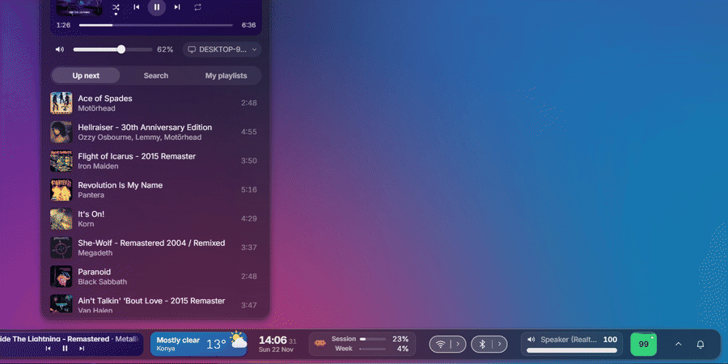

# Dockora

🇬🇧 English · [🇹🇷 Türkçe](README.md)

**Dockora** is a glass-style dock
that replaces the Windows 11 taskbar. Open apps, clock and calendar, music (including
the Spotify queue), weather, volume, battery, Wi-Fi and Bluetooth — all in one bar.

Built with Tauri 2 (Rust) + React + TypeScript. Free and open source (MIT).




<p align="center">
  
  
  
</p>
<p align="center">
  
  
</p>

> If you like it, a ⭐ (top right) helps more people find the project.

## Features

- **Open apps** – pinned and running apps in a floating glass dock
- **Clock & calendar** – subscribe to Google Calendar or any iCal feed
- **Music** – now playing controls, plus your Spotify queue (optional)
- **Weather** – current conditions for any city (Open-Meteo, no API key needed)
- **System tray** – volume, battery, Wi-Fi and Bluetooth
- **Dock-style notifications** – Windows notifications shown as dock cards (optional)
- **Customizable** – color, glass effect, size and widget placement
- **Auto-updates** – signed updates installed automatically
- **Lightweight & private** – no telemetry, no server, settings stay on your PC
- **Two languages** – English and Turkish (see [Languages](#languages))

## Installation

1. Download `Akilli.Dock_…_x64-setup.exe` from the
   [latest release](https://github.com/Bthncko/dockora/releases/latest) and run it.
   No admin rights required.
2. If Windows SmartScreen shows "Windows protected your PC", click
   **More info → Run anyway**. This appears because the app is not signed with a
   paid code-signing certificate.
3. When setup finishes, the dock opens at the bottom of your screen and starts with
   Windows from then on.

## First steps

- **Hide the Windows taskbar:** right-click an empty spot on the dock →
  **Hide the Windows taskbar**. The Windows taskbar comes back when the dock closes.
- **Settings:** same menu → **Settings…**. Color, glass, size, widget placement,
  weather city, calendar subscriptions and the language are here.
- **Calendar:** Settings → Clock & calendar → paste Google Calendar's "secret
  address in iCal format". Keep that address private.

## Languages

| Language         | Status      |
| ---------------- | ----------- |
| English          | ✅ Complete |
| Türkçe (Turkish) | ✅ Complete |

The language follows your Windows display language by default (Turkish on a Turkish
Windows, English otherwise). Change it any time in **Settings → General → Language**;
the dock, its panels, the tray menu and notifications switch immediately.

Want to add a language? The UI texts live in two places:
[`src/locales/en.ts`](src/locales/en.ts) (the dock and settings; Turkish is the source
text, each entry maps it to a translation) and [`src-tauri/src/i18n.rs`](src-tauri/src/i18n.rs)
(tray menu, right-click menus and notification cards). Pull requests are welcome.

## Updates

When a new version is released, the dock notices within a few hours, downloads and
installs it: a small progress window appears and the dock restarts for a few
seconds. You can turn this off or **Check now** under Settings → General → Updates.

## Spotify queue

Clicking the music tile opens a panel with Spotify's upcoming tracks. This needs
Spotify Premium and a Spotify developer app; the steps are in Settings → Music.

- **Create your own app** (recommended): follow the 4 steps on that page and paste
  your own Client ID.
- **Use a friend's app:** the app owner adds your Spotify email under
  developer.spotify.com → app → **User Management**, then you paste their Client
  ID. An app in development mode can be used by at most 5 people.

## Troubleshooting

- **The taskbar disappeared and won't come back:** close "Dockora" in Task
  Manager (Ctrl+Shift+Esc). If it still doesn't return, download
  [restore-taskbar.ps1](scripts/restore-taskbar.ps1), right-click it →
  **Run with PowerShell**.
- **Uninstall:** Windows Settings → Apps → Installed apps → Dockora → Uninstall.

## Privacy

The dock collects no usage data or statistics and has no server of its own.
Settings and logins stay on this computer in `%APPDATA%\com.proxd.akillidock`.
The only outbound connections are:

| Purpose             | Destination                               | What is sent                           |
| ------------------- | ----------------------------------------- | -------------------------------------- |
| Weather             | `api.open-meteo.com`                      | Coordinates of the selected city       |
| City search         | `geocoding-api.open-meteo.com`            | The city name you type                 |
| Calendar            | The iCal addresses you paste              | Only the address itself (download)     |
| Spotify (optional)  | `accounts.spotify.com`, `api.spotify.com` | Your Client ID and Spotify login       |
| AI usage (optional) | `api.anthropic.com`                       | Claude Code's session token            |
| Updates             | `github.com` (this repo)                  | Nothing; only the release file is read |

- **AI usage widget (optional):** if Claude Code is installed, the widget **only
  reads** the session token in `~/.claude/.credentials.json` and sends it only to
  Anthropic to ask for your limits. The token is never stored, modified or
  refreshed. Only counts (requests, tokens, model) are extracted from local Claude
  Code logs; message text is never stored or sent. Remove the widget and none of
  this happens.
- **Notifications:** with dock-style notifications on, Windows notifications are
  shown in the dock's own cards; their content never leaves your PC.
- **Signed updates:** the dock only installs releases signed with this repo's key.

Found a security issue? Please report it privately via **Security → Report a
vulnerability** on GitHub instead of a public issue.

## Contributing

Issues and pull requests are welcome — translations into new languages too (see [Languages](#languages)).

```sh
npm install
npm run tauri dev      # development
npm run lint && npm run format:check
cd src-tauri && cargo clippy && cargo test
```

## License

[MIT](LICENSE)
